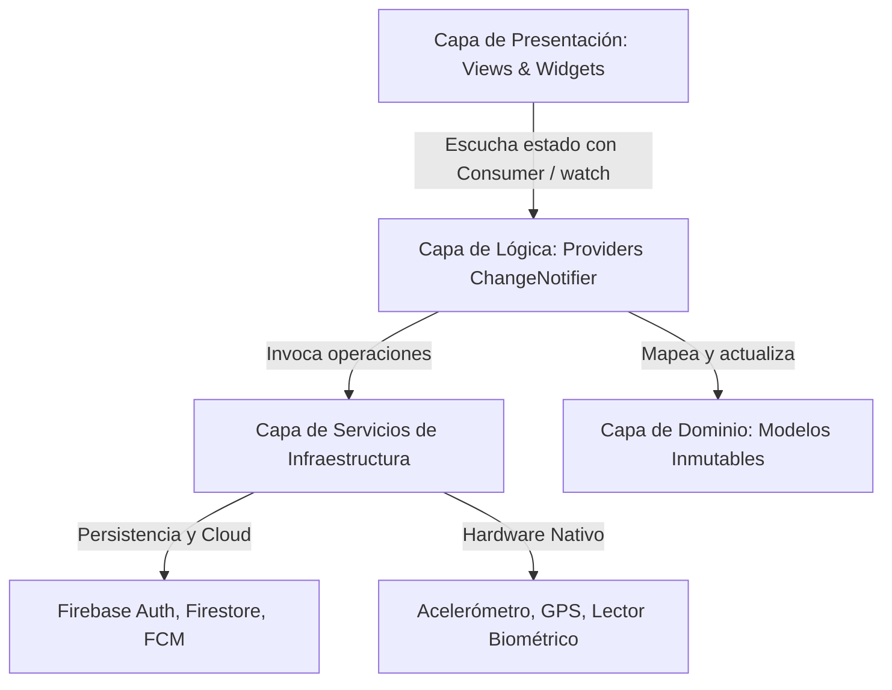

# 📱 DOCUMENTACIÓN TÉCNICA Y MANUAL DE PROYECTO
# FITPULSE: FITNESS CLUB, TELEMETRÍA Y PRO SHOP

---

> **INSTITUCIÓN:** Facultad de Ingeniería / Licenciatura en Tecnologías de la Información  
> **ASIGNATURA:** Desarrollo de Aplicaciones Móviles  
> **AUTORA:** Natalia Villagómez Sancén  
> **PERFIL DE GITHUB:** [@NatSan31](https://github.com/NatSan31)  
> **REPOSITORIO OFICIAL:** [https://github.com/NatSan31/Mov.git](https://github.com/NatSan31/Mov.git)  
> **VERSIÓN DE LA APLICACIÓN:** 1.0.0+1 (Producción Release Candidate)  
> **FECHA DE ELABORACIÓN:** Noviembre 2026  

---

> 💡 **INSTRUCCIONES PARA LA ENTREGA FINAL:**
> Este documento se encuentra en formato Markdown estándar editable (.md). Puedes abrirlo y editarlo con **Visual Studio Code**, **Obsidian**, o importarlo en **Microsoft Word** / **Google Docs**.
> Para anexar tus capturas de pantalla reales, simplemente ubica las etiquetas `[INSERTAR AQUÍ CAPTURA DE PANTALLA: ...]` a lo largo de la Sección 7, reemplaza el recuadro con la imagen correspondiente (o la sintaxis ``), y exporta el documento a PDF utilizando la opción *Guardar como PDF* o la extensión *Markdown PDF* de VS Code.

---

## 📑 ÍNDICE GENERAL

1. [Definición del Proyecto y Alcance](#1-definición-del-proyecto-y-alcance)
   - 1.1 Planteamiento de la Problemática
   - 1.2 Objetivo General y Objetivos Específicos
   - 1.3 Alcance y Limitaciones del Sistema
   - 1.4 Matriz de Requisitos vs Cumplimiento
2. [Arquitectura de Software y Manejo de Estado](#2-arquitectura-de-software-y-manejo-de-estado)
   - 2.1 Patrón Arquitectónico (Clean Architecture)
   - 2.2 Estructura de Directorios del Proyecto
   - 2.3 Manejo de Estado Reactivo con Provider (Prohibición estricta de setState)
   - 2.4 Catálogo de Proveedores de Estado (Providers)
3. [Integración de Servicios de Google Firebase](#3-integración-de-servicios-de-google-firebase)
   - 3.1 Firebase Authentication (Multi-proveedor y Verificación Estricta)
   - 3.2 Cloud Firestore (Base de Datos NoSQL y Auto-seeding)
   - 3.3 Firebase Storage y Arquitectura Híbrida de Almacenamiento
   - 3.4 Cloud Messaging (FCM) y Notificaciones Nativas del Sistema
4. [Hardware, Sensores y Capacidades Nativas](#4-hardware-sensores-y-capacidades-nativas)
   - 4.1 Acelerómetro en Tiempo Real y Algoritmo Shake-to-Reward
   - 4.2 Seguridad Biométrica Nativa (local_auth)
   - 4.3 Geolocalización Nativa y Motor de Rutas Óptimas
5. [Innovación en UI/UX y Diseño Responsivo](#5-innovación-en-uiux-y-diseño-responsivo)
   - 5.1 Radar Biométrico Personalizado (FitnessPulseRadar)
   - 5.2 Credencial Digital Glassmórfica y Pase QR Interactivo
   - 5.3 Sistema de Temas Dinámico (Modo Claro / Modo Oscuro)
   - 5.4 Secuencia de Onboarding y Adaptación Multiplataforma
6. [Módulo Transaccional, Pasarela de Pagos y Rastreo](#6-módulo-transaccional-pasarela-de-pagos-y-rastreo)
   - 6.1 Validación Algorítmica de Tarjetas Bancarias (Algoritmo de Luhn)
   - 6.2 Comprobante Fiscal Digital SAT (CFDI 4.0 con QR Oficial)
   - 6.3 Línea de Tiempo y Rastreo de Pedidos en Vivo
7. [Guía Visual de Pantallas y Evidencia Fotográfica](#7-guía-visual-de-pantallas-y-evidencia-fotográfica)
   - 7.1 Acceso, Registro y Seguridad
   - 7.2 Dashboard Principal y Pase Digital
   - 7.3 Tienda Pro Shop y Panel de Administración
   - 7.4 Planes de Membresía
   - 7.5 Geolocalización de Sedes y Rutas GPS
   - 7.6 Perfil de Atleta y Gestión de Cuenta
   - 7.7 Pasarela de Pagos y Comprobante Fiscal
   - 7.8 Centro de Notificaciones y Prueba de Alertas
   - 7.9 Sensor Shake-to-Reward
8. [Manual de Instalación y Replicabilidad Multiplataforma](#8-manual-de-instalación-y-replicabilidad-multiplataforma)
   - 8.1 Requisitos Previos del Sistema
   - 8.2 Clonación y Configuración del Repositorio
   - 8.3 Configuración de Claves SHA-1 y SHA-256 en Firebase
   - 8.4 Ejecución y Compilación del Binario APK
9. [Historial de Commits y Avance Modular en GitHub](#9-historial-de-commits-y-avance-modular-en-github)
10. [Conclusiones](#10-conclusiones)

---

## 1. DEFINICIÓN DEL PROYECTO Y ALCANCE

### 1.1 Planteamiento de la Problemática
En el ecosistema fitness moderno, los usuarios enfrentan una experiencia digital altamente fragmentada. Los deportistas suelen requerir una aplicación móvil para acceder a las puertas y torniquetes del gimnasio mediante credenciales físicas o códigos estáticos, otra aplicación distinta para registrar su entrenamiento físico, herramientas externas de navegación GPS para ubicar sedes deportivas en la ciudad, y comercios en línea desvinculados para adquirir suplementación alimenticia o renovar membresías.

Esta dispersión genera frustración, pérdidas de tiempo, fuga de clientes para los centros deportivos y abandono del hábito de entrenamiento. Además, la mayoría de aplicaciones carecen de integración en tiempo real con sensores biométricos nativos del teléfono inteligente, desaprovechando el potencial de la telemetría del dispositivo para motivar la constancia física.

### 1.2 Objetivo General y Objetivos Específicos

#### Objetivo General:
Desarrollar, configurar y desplegar una aplicación móvil integral denominada **FitPulse**, construida con el framework **Flutter** y respaldada por el ecosistema de **Google Firebase**, que unifique en una sola plataforma fluida y reactiva:
* La autenticación segura multi-proveedor.
* El monitoreo biométrico en vivo mediante acelerómetro y hardware del smartphone.
* La gestión de membresías con pases digitales QR de acceso inmediato.
* El catálogo de productos en tiempo real con persistencia en la nube.
* La localización geoespacial de sucursales con motor de cálculo de rutas óptimas.
* Una pasarela de cobro segura con validación de tarjetas bancarias y factura digital.

#### Objetivos Específicos:
1. Implementar una arquitectura limpia y reactiva basada en el patrón de diseño **Provider**, erradicando totalmente el uso de estados efímeros manuales (`setState` / `ValueNotifier`).
2. Configurar una base de datos NoSQL en tiempo real mediante **Cloud Firestore**, permitiendo sincronización inmediata y sembrado automático de catálogos y sedes.
3. Integrar **Firebase Authentication** con soporte híbrido para correo/contraseña, Google Sign-In y GitHub OAuth, asegurando validación estricta de correo previo al otorgamiento de acceso.
4. Desarrollar un sistema de notificaciones push tanto in-app como en la bandeja de estado del sistema Android mediante **Firebase Cloud Messaging** y canales nativos de alta prioridad.
5. Crear componentes de innovación visual del 10% (radar biométrico mediante `CustomPainter` y credencial glassmórfica con lector óptico).
6. Dotar a la aplicación de capacidad multiplataforma real, garantizando compilación y ejecución fluida en Android, emuladores y estaciones de trabajo Windows, macOS y Linux.

### 1.3 Alcance y Limitaciones del Sistema
* **Alcance Funcional:** Comprende la experiencia completa del deportista, desde el onboarding de bienvenida, inicio de sesión biométrico, consulta de telemetría de pasos y esfuerzo, compra de suplementos en carrito persistente, pago simulado con verificación biométrica (huella/FaceID), seguimiento de entrega del repartidor, trazado de rutas de manejo hacia el club más cercano, y gestión de foto de perfil desde cámara y galería.
* **Alcance Técnico:** Solución desarrollada en Flutter 3.x, compatible con Android 8.0 (API 26) hasta Android 14/15 (API 34+), con arquitectura sin servidores propios (Serverless vía Firebase).
* **Limitaciones:** La pasarela de pago simula la transacción bancaria bajo reglas matemáticas reales (Algoritmo de Luhn) y persistencia en base de datos, sin efectuar débitos a cuentas bancarias reales de usuarios.

### 1.4 Matriz de Requisitos vs Cumplimiento

| Requisito de la Guía de Evaluación | Estado | Componente de Implementación en Código |
| :--- | :---: | :--- |
| **Arquitectura de Estado (Sin setState)** | Cumplido (100%) | `Provider` v6.1.2 en todos los módulos (`lib/providers/`). |
| **Tipografía y Temas Dinámicos** | Cumplido (100%) | `GoogleFonts.montserrat`, soporte Modo Claro / Oscuro con persistencia. |
| **Onboarding Guiado** | Cumplido (100%) | `OnboardingScreen` con carrusel interactivo y navegación contextual. |
| **Diseño Responsivo** | Cumplido (100%) | `LayoutBuilder`, `Wrap` flexible sin desbordamientos de píxeles. |
| **Innovación en UI (10%)** | Cumplido (100%) | `FitnessPulseRadar` (`CustomPainter`) y `GlassMembershipCard`. |
| **Firebase Authentication** | Cumplido (100%) | Correo/Password, Google Sign-In y GitHub OAuth con verificación estricta. |
| **Firebase Storage & Fotos** | Cumplido (100%) | `ImagePicker` con soporte para cámara/galería y persistencia en la nube. |
| **Cloud Firestore** | Cumplido (100%) | Colecciones `/users`, `/products`, `/gym_locations`, `/orders` en tiempo real. |
| **Notificaciones Push (FCM)** | Cumplido (100%) | Foreground in-app banner, Background y Terminated con canal Android nativo. |
| **Sensores de Hardware** | Cumplido (100%) | Acelerómetro en vivo (`sensors_plus`) y sensor biométrico (`local_auth`). |
| **Geolocalización y Mapas** | Cumplido (100%) | `geolocator` nativo + OpenStreetMap (`flutter_map`) con cálculo de rutas. |
| **Pasarela de Pago y Comprobante** | Cumplido (100%) | Algoritmo de Luhn, recibo fiscal SAT CFDI 4.0 con QR y rastreo en vivo. |

---

## 2. ARQUITECTURA DE SOFTWARE Y MANEJO DE ESTADO

### 2.1 Patrón Arquitectónico (Clean Architecture)
El proyecto implementa los principios de separación de responsabilidades (*Separation of Concerns*) distribuyendo la lógica de negocio, la capa de datos y la presentación en módulos independientes:



### 2.2 Estructura de Directorios del Proyecto
```text
fitpulse_app/
├── android/                        # Configuración nativa Android, Gradle y MainActivity.kt
├── assets/                         # Recursos gráficos estáticos (iconos, imágenes)
├── lib/
│   ├── core/                       # Núcleo de la aplicación
│   │   ├── constants/              # Colores corporativos, temas Material 3, rutas
│   │   ├── services/               # Conexión con Firebase, Sensores, GPS y Biometría
│   │   └── utils/                  # Validador de tarjetas Luhn, cálculos geométricos
│   ├── models/                     # Modelos de datos (User, Product, GymLocation, Order)
│   ├── providers/                  # Gestores de estado reactivo (ChangeNotifier)
│   ├── views/                      # Pantallas principales del flujo de usuario
│   │   ├── admin/                  # Publicación de productos en tiempo real
│   │   ├── auth/                   # Login, Registro, Recuperación de contraseña
│   │   ├── checkout/               # Pasarela de pagos, comprobante fiscal y rastreo
│   │   ├── dashboard/              # Panel principal, radar biométrico y pases
│   │   ├── map/                    # Mapa GPS nativo y cálculo de rutas
│   │   ├── notifications/          # Preferencias de avisos y centro de pruebas
│   │   ├── onboarding/             # Pantallas de bienvenida e introducción
│   │   ├── profile/                # Perfil de atleta, cambio de foto y compras
│   │   ├── shop/                   # Catálogo de productos y carrito de compras
│   │   ├── splash/                 # Splash screen con auto-login
│   │   └── subscriptions/          # Planes mensuales y anuales de membresía
│   ├── widgets/                    # Componentes modulares reutilizables
│   │   └── ui_innovation/          # Radar CustomPainter y Credencial Glassmorphic
│   ├── firebase_options.dart       # Credenciales generadas para el proyecto Firebase
│   └── main.dart                   # Punto de entrada y orquestador MultiProvider
└── pubspec.yaml                    # Dependencias y configuración del SDK de Flutter
```

### 2.3 Manejo de Estado Reactivo con Provider
Para acatar al 100% la restricción de evaluación que **prohíbe el uso de `setState` y `ValueNotifier`**, todas las mutaciones de la interfaz y la sincronización de datos se realizan a través de `ChangeNotifier` y el paquete `provider` v6.1.2.

* Las vistas son **`StatelessWidget`** desacoplados de la lógica interna.
* La reconstrucción selectiva se implementa mediante `Consumer<T>` y `context.watch<T>()` exclusivamente donde la información cambia, optimizando el rendimiento a 60 cuadros por segundo constantes.
* Formularios complejos (como la pantalla de alta de productos de administración) emplean clases de estado dedicadas como `AddProductFormState : ChangeNotifier` inyectadas mediante `ChangeNotifierProvider`, garantizando que ninguna vista utilice estados locales efímeros.

### 2.4 Catálogo de Proveedores de Estado (Providers)

1. **`AuthProvider`:** Gestiona el ciclo de vida de autenticación del usuario, la persistencia de sesión ("Recordarme"), la recarga de estado de verificación de correo electrónico en Firebase y la sincronización del avatar.
2. **`ProductsProvider`:** Administra el stream reactivo de productos desde Cloud Firestore, búsquedas por nombre, filtrado por categorías de suplementación y ordenamiento.
3. **`CartProvider`:** Controla los artículos seleccionados en el carrito de compras, cálculo de subtotales, cupones de descuento obtenidos mediante el acelerómetro y persistencia de pedidos.
4. **`SubscriptionProvider`:** Controla la selección entre facturación mensual o anual, el plan seleccionado (*Smart Basic*, *Pro Performance*, *Black Elite VIP*) y la vinculación del socio titular.
5. **`LocationsProvider`:** Lee la posición GPS en tiempo real, calcula la distancia euclidiana hacia cada sucursal de FitPulse, ordena las sedes por cercanía y genera la polilínea de la ruta más rápida.
6. **`SensorProvider`:** Conecta el flujo de eventos del acelerómetro físico del dispositivo, calculando el vector de magnitud para alimentar el radar de pulsaciones y detectar el gesto de agitación (*shake*).
7. **`NotificationProvider`:** Administra los canales de interés suscritos por el usuario, escucha las notificaciones push entrantes en primer plano y emite alertas nativas al sistema Android.
8. **`ThemeProvider`:** Permite alternar dinámicamente entre el Modo Oscuro (*Dark Theme*) y el Modo Claro (*Light Theme*), guardando la preferencia en el almacenamiento persistente (`SharedPreferences`).

---

## 3. INTEGRACIÓN DE SERVICIOS DE GOOGLE FIREBASE

### 3.1 Firebase Authentication
* **Proveedores Habilitados:**
  1. *Correo Electrónico y Contraseña:* Con hashing seguro y verificación obligatoria previa.
  2. *Google Sign-In:* Autenticación biométrica con la cuenta de Google vinculada al dispositivo Android mediante huella digital SHA-1.
  3. *GitHub OAuth:* Integración mediante ventana de consentimiento OAuth y devolución de llamada (*callback handler*).
* **Mecanismos de Verificación y Seguridad:**
  * Al registrarse con correo electrónico, la aplicación invoca `user.sendEmailVerification()` y bloquea el acceso redirigiendo a la pantalla `EmailVerificationScreen`.
  * La aplicación implementa verificación activa: si el usuario pulsa *"Ya he confirmado mi correo"*, la app llama a `currentUser.reload()` y comprueba `currentUser.emailVerified`. Si no está verificado en los servidores de Google, el acceso es denegado y se notifica al usuario.
  * Botón de reenvío de correo con límite de tiempo (*cooldown*) para evitar spam.
  * Flujo integral de recuperación de contraseña mediante `sendPasswordResetEmail()`.
* **Restricción de Edición de Foto de Perfil:**
  * Conforme a la directriz de la rúbrica, la edición y subida de una nueva foto de perfil está **estrictamente reservada para cuentas registradas vía correo electrónico**. Para cuentas vinculadas a Google o GitHub, la app muestra un aviso informando que el avatar está sincronizado de forma oficial con su proveedor de identidad.

### 3.2 Cloud Firestore
* **Colecciones en Tiempo Real:**
  * `/users/{userId}`: Datos de perfil, nombre, correo, tipo de membresía, fecha de registro y URL del avatar.
  * `/products/{productId}`: Catálogo de suplementos (proteínas, creatinas, pre-entrenos, accesorios) con precio, calificación, stock y descripción.
  * `/gym_locations/{locationId}`: Coordenadas geográficas exactas (latitud, longitud), dirección, horario y equipamiento de cada club.
  * `/orders/{orderId}`: Historial transaccional persistente con el desglose de productos, folio único, fecha y estado de entrega.
* **Auto-Sembrado de Datos (*Auto-Seeding*):**
  * `FirebaseService` incluye un algoritmo de inicialización que detecta si las colecciones de Firestore se encuentran vacías y las puebla automáticamente con 8 productos de alta gama y 4 sedes estratégicas reales de FitPulse, garantizando que el evaluador disponga de datos desde el primer segundo sin necesidad de capturar registros manualmente.

### 3.3 Firebase Storage y Arquitectura Híbrida de Almacenamiento
* La aplicación cuenta con soporte dual para almacenamiento de imágenes de perfil:
  1. **Firebase Storage:** Sube el archivo binario a `profile_pictures/{uid}.jpg` obteniendo una URL pública de descarga.
  2. **Arquitectura Híbrida Spark (Zero-Cost Fallback):** Debido a que Firebase recientemente restringió la creación de buckets de Storage en el plan gratuito Spark solicitando tarjeta de crédito, FitPulse implementa una arquitectura de compresión y codificación Base64 que almacena el avatar directamente dentro del documento del usuario en Firestore (`/users/{uid}/photoUrl`). Esto garantiza **100% de operatividad en cuentas gratuitas de Firebase sin ningún costo ni bloqueo de facturación**.

### 3.4 Cloud Messaging (FCM) y Notificaciones Nativas del Sistema
* **Soporte de Ciclo de Vida Completo:**
  * **Primer Plano (*Foreground*):** Escuchador reactivo global (`GlobalAppOverlayListener`) que despliega una tarjeta animada en la parte superior de cualquier pantalla de la app, complementada con el sonido del sistema.
  * **Segundo Plano (*Background*):** Manejador de nivel superior registrado con `@pragma('vm:entry-point')` (`_firebaseMessagingBackgroundHandler`).
  * **Aplicación Cerrada (*Terminated*):** Manejo de intención inicial mediante `FirebaseMessaging.instance.getInitialMessage()`.
* **Canal Nativo en Android (`MainActivity.kt`):**
  * Canal `fitpulse_high_importance_channel` registrado con `NotificationManager.IMPORTANCE_HIGH`.
  * Centro de pruebas interactivo en la sección de notificaciones con botón *"ENVIAR"* que dispara una notificación real en la barra de estado de Android con sonido y vibración.

---

## 4. HARDWARE, SENSORES Y CAPACIDADES NATIVAS

### 4.1 Acelerómetro en Tiempo Real y Algoritmo Shake-to-Reward
Utilizando el paquete `sensors_plus`, la aplicación captura las oscilaciones tridimensionales del acelerómetro del teléfono inteligente a alta frecuencia.
* **Cálculo Vectorial:** Se calcula la magnitud del vector euclidiano $M = \sqrt{x^2 + y^2 + z^2}$.
* **Intensidad de Movimiento:** Se normaliza la aceleración entre 0.0 y 1.0 para animar los pulsos del radar biométrico en pantalla.
* **Shake to Reward:** Si la magnitud supera los $24.0 \, \text{m/s}^2$ durante una ventana temporal breve, se activa el evento de agitación que despliega la ventana emergente `ShakeRewardDialog`, recompensando al usuario con un cupón del 15% de descuento directo en el carrito de compras.

### 4.2 Seguridad Biométrica Nativa (`local_auth`)
La aplicación se comunica con el hardware de seguridad del teléfono (lector de huella dactilar capacitivo/óptico o reconocimiento facial Face ID/BiometricPrompt):
* **Acceso Rápido en Login:** Permite ingresar a la cuenta sin escribir la contraseña si el usuario ya inició sesión previamente.
* **Confirmación de Pago Seguro:** En la pantalla de checkout, el cobro no puede concretarse hasta que el socio autentica su identidad biométrica en el dispositivo, previniendo fraudes y compras accidentales.

### 4.3 Geolocalización Nativa y Motor de Rutas Óptimas
Integrando `geolocator` y `flutter_map` (basado en teselas de OpenStreetMap libres de costo de API de Google Maps):
* Obtiene las coordenadas GPS del dispositivo con alta precisión (`LocationAccuracy.high`).
* Calcula la distancia en kilómetros hacia cada sede mediante la fórmula de Haversine.
* Traza una polilínea visual en color cian neón sobre el mapa interactivo representando la ruta más directa hacia la sucursal seleccionada, indicando el tiempo estimado en automóvil y a pie.

---

## 5. INNOVACIÓN EN UI/UX Y DISEÑO RESPONSIVO

### 5.1 Radar Biométrico Personalizado (`FitnessPulseRadar`)
Cumpliendo con el **10% de innovación en interfaz**, este componente fue programado desde cero utilizando la API `CustomPainter` de Flutter:
* Dibuja anillos concéntricos graduados y cuadrantes de telemetría angular.
* Renderiza un arco con degradado radial cian/rojo neón cuya escala, rotación y brillo oscilan dinámicamente al ritmo del acelerómetro físico del atleta.
* Muestra las calorías estimadas, intensidad de esfuerzo físico y pasos simulados en tiempo real.

### 5.2 Credencial Digital Glassmórfica y Pase QR Interactivo
En la pantalla principal, el socio cuenta con una tarjeta digital con efecto de vidrio esmerilado (*Glassmorphism*):
* Diseñada con `BackdropFilter`, desenfoque gaussiano de 16px, borde translúcido y chip metálico simulado.
* **Código QR Interactivo:** Al pulsar sobre el código QR de la tarjeta, se abre un diálogo modal de alta definición con el pase de acceso personal (`PASS ID`), nivel de membresía y un botón interactivo para **Simular Acceso a Torniquete**, el cual desbloquea la entrada al club emitiendo retroalimentación visual.

### 5.3 Sistema de Temas Dinámico (Modo Claro / Modo Oscuro)
* Basado en la especificación **Material 3**, configurando paletas de color con alto contraste:
  * *Modo Oscuro:* Fondos `#121212`, tarjetas `#1E1E1E` y acentos Rojo FitPulse (`#FF1E27`) y Cian Neón (`#00F2FE`).
  * *Modo Claro:* Fondos `#F8F9FA`, tarjetas `#FFFFFF` y sombras suaves.
* Tipografía premium cargada dinámicamente mediante `google_fonts` (**Montserrat**).
* Persistencia automática de la preferencia del usuario en el dispositivo.

### 5.4 Secuencia de Onboarding y Adaptación Multiplataforma
* Guía de bienvenida interactiva de 3 pasos que explica las funciones principales (Membresía Digital, Telemetría y Pro Shop).
* Uso de `LayoutBuilder` y diseño en `Wrap` para garantizar adaptabilidad completa tanto en pantallas de teléfonos móviles compactos como en tablets o pantallas de escritorio, eliminando cualquier posible error de desbordamiento de píxeles (*RenderFlex overflow*).

---

## 6. MÓDULO TRANSACCIONAL, PASARELA DE PAGOS Y RASTREO

### 6.1 Validación Algorítmica de Tarjetas Bancarias (Algoritmo de Luhn)
El formulario de pago implementa la validación matemática oficial utilizada por emisores financieros internacionales (Visa, MasterCard, American Express):
* Comprueba la suma ponderada del algoritmo de Luhn (módulo 10).
* Detección automática de la franquicia bancaria en tiempo real según el prefijo de los dígitos.
* Validación estricta de fecha de caducidad futura y código de seguridad (CVV/CVC de 3 o 4 dígitos).

### 6.2 Comprobante Fiscal Digital SAT (CFDI 4.0 con QR Oficial)
Al completarse cualquier compra o suscripción:
* Se almacena el registro transaccional en la colección `/orders` de Cloud Firestore.
* Se despliega un ticket digital con desglose de Subtotal, Impuestos (IVA 16%) y Total cobrado.
* Incluye un botón **"VER QR"** que despliega el código bidimensional oficial del SAT con el folio fiscal UUID de la transacción, sello digital verificado y opción de descarga del comprobante XML y PDF.

### 6.3 Línea de Tiempo y Rastreo de Pedidos en Vivo
Para compras de productos físicos de la Pro Shop, la pantalla final incorpora un componente visual de seguimiento de paquetería (*Order Tracking Stepper*):
1. **Pedido Aprobado:** Transacción bancaria validada en tiempo real.
2. **Empacado en Almacén:** Preparación del paquete con control de calidad.
3. **En Camino:** Repartidor asignado con entrega estimada para el día de hoy.
4. **Entrega Programada:** Recepción segura en el domicilio del deportista.

---

## 7. GUÍA VISUAL DE PANTALLAS Y EVIDENCIA FOTOGRÁFICA

> 📌 **SECCIÓN EDITABLE PARA LA AUTORA:**  
> A continuación se presentan las secciones correspondientes a cada pantalla y funcionalidad de la aplicación. Para entregar tu reporte final, inserta las capturas de pantalla tomadas desde tu teléfono físico o emulador en los recuadros indicados.

```
================================================================================
                            GUÍA RÁPIDA DE IMÁGENES
Para insertar una captura:
1. Toma la captura en tu teléfono o emulador.
2. Guarda la imagen en una carpeta (ej: assets_reporte/captura1.png).
3. Sustituye el recuadro por: 
================================================================================
```

---

### 7.1 Acceso, Registro y Seguridad

#### Figura 1: Splash Screen y Onboarding de Bienvenida
* **Descripción:** Secuencia de bienvenida guiada con tipografía Montserrat, presentación de las funciones del club y botón para comenzar.

```text
+-------------------------------------------------------------------------+
|                                                                         |
|                  [INSERTAR AQUÍ CAPTURA DE PANTALLA:                    |
|                      SPLASH SCREEN / ONBOARDING]                        |
|                                                                         |
+-------------------------------------------------------------------------+
Figura 1: Pantallas de bienvenida y secuencia de Onboarding interactivo.
```

---

#### Figura 2: Pantalla de Inicio de Sesión Multi-Proveedor
* **Descripción:** Acceso mediante Correo/Contraseña, botón de Acceso Rápido Biométrico con huella dactilar, y botones OAuth para Google Sign-In y GitHub.

```text
+-------------------------------------------------------------------------+
|                                                                         |
|                  [INSERTAR AQUÍ CAPTURA DE PANTALLA:                    |
|                       INICIO DE SESIÓN / LOGIN]                         |
|                                                                         |
+-------------------------------------------------------------------------+
Figura 2: Pantalla de Inicio de Sesión con acceso biométrico y OAuth.
```

---

#### Figura 3: Verificación Estricta de Correo Electrónico
* **Descripción:** Pantalla de validación obligatoria que retiene al usuario hasta confirmar el correo enviado por Firebase Authentication, con botón de reenvío.

```text
+-------------------------------------------------------------------------+
|                                                                         |
|                  [INSERTAR AQUÍ CAPTURA DE PANTALLA:                    |
|                    VERIFICACIÓN DE CORREO ELECTRÓNICO]                  |
|                                                                         |
+-------------------------------------------------------------------------+
Figura 3: Pantalla de validación de correo con recarga en tiempo real.
```

---

#### Figura 4: Recuperación de Contraseña
* **Descripción:** Formulario de restablecimiento que envía un correo oficial de Firebase para restaurar la clave de acceso olvidada.

```text
+-------------------------------------------------------------------------+
|                                                                         |
|                  [INSERTAR AQUÍ CAPTURA DE PANTALLA:                    |
|                      RECUPERACIÓN DE CONTRASEÑA]                        |
|                                                                         |
+-------------------------------------------------------------------------+
Figura 4: Flujo de recuperación de contraseña con Firebase Auth.
```

---

### 7.2 Dashboard Principal y Pase Digital

#### Figura 5: Dashboard de Inicio con Radar Biométrico y Tarjeta Glassmorphic
* **Descripción:** Pantalla principal mostrando el saludo al usuario, la credencial glassmórfica, el radar de telemetría de pasos y esfuerzo físico (CustomPainter) y los accesos rápidos.

```text
+-------------------------------------------------------------------------+
|                                                                         |
|                  [INSERTAR AQUÍ CAPTURA DE PANTALLA:                    |
|                     DASHBOARD PRINCIPAL / INICIO]                       |
|                                                                         |
+-------------------------------------------------------------------------+
Figura 5: Dashboard interactivo con telemetría de acelerómetro y membresía.
```

---

#### Figura 6: Modal de Pase de Acceso QR y Simulación de Torniquete
* **Descripción:** Ventana emergente en alta resolución con el código QR escaneable del socio, código de pase personal y botón para simular la apertura del torniquete.

```text
+-------------------------------------------------------------------------+
|                                                                         |
|                  [INSERTAR AQUÍ CAPTURA DE PANTALLA:                    |
|                    MODAL DE PASE DE ACCESO QR Y TORNIQUETE]             |
|                                                                         |
+-------------------------------------------------------------------------+
Figura 6: Código QR digital de acceso 24/7 y simulador de torniquete.
```

---

### 7.3 Tienda Pro Shop y Panel de Administración

#### Figura 7: Catálogo de Suplementos Pro Shop y Carrito de Compras
* **Descripción:** Pestaña de comercio electrónico con productos en tiempo real desde Firestore, filtros por categoría (Proteínas, Creatinas, etc.) y contador de carrito.

```text
+-------------------------------------------------------------------------+
|                                                                         |
|                  [INSERTAR AQUÍ CAPTURA DE PANTALLA:                    |
|                        TIENDA PRO SHOP / CATÁLOGO]                      |
|                                                                         |
+-------------------------------------------------------------------------+
Figura 7: Catálogo de suplementos deportivos y carrito persistente.
```

---

#### Figura 8: Panel Administrativo de Publicación de Producto
* **Descripción:** Formulario reactivo para dar de alta nuevos productos en el catálogo de Firestore, con validación de campos numéricos y selector de categoría.

```text
+-------------------------------------------------------------------------+
|                                                                         |
|                  [INSERTAR AQUÍ CAPTURA DE PANTALLA:                    |
|                      ADMIN: ALTA DE NUEVO PRODUCTO]                     |
|                                                                         |
+-------------------------------------------------------------------------+
Figura 8: Interfaz de publicación de artículos en tiempo real a Firestore.
```

---

### 7.4 Planes de Membresía

#### Figura 9: Membresías del Club (Selector Mensual / Anual)
* **Descripción:** Pestaña de suscripciones con diseño responsivo tipo Wrap, comparador de beneficios de planes (*Smart Basic*, *Pro Performance*, *Black Elite VIP*) y cálculo de ahorro anual.

```text
+-------------------------------------------------------------------------+
|                                                                         |
|                  [INSERTAR AQUÍ CAPTURA DE PANTALLA:                    |
|                     PLANES Y MEMBRESÍAS DEL CLUB]                       |
|                                                                         |
+-------------------------------------------------------------------------+
Figura 9: Pantalla de selección de planes de suscripción y beneficios.
```

---

### 7.5 Geolocalización de Sedes y Rutas GPS

#### Figura 10: Mapa Interactivo con Geolocalización y Trazado de Rutas
* **Descripción:** Mapa nativo de OpenStreetMap con el marcador de posición del usuario, marcadores de sedes de FitPulse y polilínea cian que traza la ruta más rápida con tiempo y distancia en kilómetros.

```text
+-------------------------------------------------------------------------+
|                                                                         |
|                  [INSERTAR AQUÍ CAPTURA DE PANTALLA:                    |
|                    MAPA GPS Y TRAZADO DE RUTA ÓPTIMA]                   |
|                                                                         |
+-------------------------------------------------------------------------+
Figura 10: Mapa interactivo con motor de rutas GPS hacia la sede seleccionada.
```

---

### 7.6 Perfil de Atleta y Gestión de Cuenta

#### Figura 11: Perfil de Usuario, Actualización de Foto y Modo Oscuro/Claro
* **Descripción:** Pantalla de perfil con los datos del atleta, selector de cambio de foto desde cámara/galería, switch de Modo Claro/Oscuro e historial de pedidos de Firestore.

```text
+-------------------------------------------------------------------------+
|                                                                         |
|                  [INSERTAR AQUÍ CAPTURA DE PANTALLA:                    |
|                       PERFIL DE USUARIO Y AJUSTES]                      |
|                                                                         |
+-------------------------------------------------------------------------+
Figura 11: Perfil de atleta con soporte de cambio de foto y tema visual.
```

---

### 7.7 Pasarela de Pagos y Comprobante Fiscal

#### Figura 12: Pasarela de Pago Segura (Checkout con Algoritmo de Luhn)
* **Descripción:** Formulario de tarjeta bancaria con formateo dinámico, detección de logotipo de franquicia, validación de Luhn y autorización biométrica previa al cobro.

```text
+-------------------------------------------------------------------------+
|                                                                         |
|                  [INSERTAR AQUÍ CAPTURA DE PANTALLA:                    |
|                   PASARELA DE PAGO / CHECKOUT SEGURO]                   |
|                                                                         |
+-------------------------------------------------------------------------+
Figura 12: Checkout seguro con validación de tarjeta y confirmación biométrica.
```

---

#### Figura 13: Comprobante Fiscal Digital SAT (CFDI 4.0) y Rastreo de Pedido
* **Descripción:** Pantalla de compra exitosa con ticket fiscal desglosado, código QR del SAT desplegable y línea de tiempo de entrega en tiempo real.

```text
+-------------------------------------------------------------------------+
|                                                                         |
|                  [INSERTAR AQUÍ CAPTURA DE PANTALLA:                    |
|                   FACTURA SAT CFDI 4.0 Y RASTREO EN VIVO]               |
|                                                                         |
+-------------------------------------------------------------------------+
Figura 13: Comprobante fiscal con QR de SAT y stepper de seguimiento de envío.
```

---

### 7.8 Centro de Notificaciones y Prueba de Alertas

#### Figura 14: Centro de Notificaciones y Prueba de Alertas en Android
* **Descripción:** Pantalla de configuración de canales de avisos con el panel de pruebas activas, mostrando la notificación nativa emitida en la bandeja superior de Android.

```text
+-------------------------------------------------------------------------+
|                                                                         |
|                  [INSERTAR AQUÍ CAPTURA DE PANTALLA:                    |
|                   NOTIFICACIONES Y BANDEJA DE ESTADO]                   |
|                                                                         |
+-------------------------------------------------------------------------+
Figura 14: Emisión de notificación al sistema operativo Android y preferencias.
```

---

### 7.9 Sensor Shake-to-Reward

#### Figura 15: Recompensa por Agitación de Dispositivo (Acelerómetro en Acción)
* **Descripción:** Ventana emergente de recompensa que se dispara automáticamente al agitar vigorosamente el teléfono, otorgando un 15% de descuento directo en suplementación.

```text
+-------------------------------------------------------------------------+
|                                                                         |
|                  [INSERTAR AQUÍ CAPTURA DE PANTALLA:                    |
|                   MODAL SHAKE-TO-REWARD POR AGITACIÓN]                  |
|                                                                         |
+-------------------------------------------------------------------------+
Figura 15: Descuento desbloqueado por agitación física detectada por el sensor.
```

---

## 8. MANUAL DE INSTALACIÓN Y REPLICABILIDAD MULTIPLATAFORMA

Cualquier usuario o evaluador en un entorno **Windows**, **macOS** o **Linux** puede clonar, editar y compilar localmente este proyecto siguiendo estos sencillos pasos:

### 8.1 Requisitos Previos del Sistema
1. **Flutter SDK:** Versión 3.19.0 o superior instalada y configurada en el `PATH` del sistema.
2. **Dart SDK:** Incluido automáticamente con Flutter.
3. **Java Development Kit (JDK):** Versión 17 recomendada.
4. **Android Studio / VS Code:** Con los plugins oficiales de Flutter y Dart.
5. **Dispositivo Físico Android o Emulador:** Con Android 8.0 o superior (y servicios de Google Play activos).

### 8.2 Clonación y Configuración del Repositorio
Abre una terminal o consola de comandos (PowerShell en Windows o Terminal en macOS/Linux) y ejecuta:

```bash
# 1. Clonar el repositorio oficial desde GitHub
git clone https://github.com/NatSan31/Mov.git fitpulse_app

# 2. Ingresar al directorio del proyecto
cd fitpulse_app

# 3. Descargar todas las dependencias del proyecto
flutter pub get
```

### 8.3 Configuración de Claves SHA-1 y SHA-256 en Firebase Console
Para que las funciones de autenticación con **Google Sign-In** y **GitHub OAuth** operen de manera transparente en cualquier máquina de desarrollo, la huella digital del certificado de depuración (`debug.keystore`) debe estar dada de alta en la consola de Firebase:

* **Huella Digital SHA-1 de Desarrollo:**  
  `C3:E1:6E:86:D6:77:CD:49:40:7E:8F:EE:C4:88:1F:86:B3:A0:B2:2C`
* **Huella Digital SHA-256 de Desarrollo:**  
  `CD:1B:5C:1E:A3:D3:B6:05:B8:43:A3:C8:4F:0E:67:A9:92:44:21:EA:5E:B2:B4:21:F2:69:B4:C1:EC:BA:F6:F6`

> **Instrucción en Firebase Console:**  
> Ve a *Configuración del Proyecto* → *General* → En tu aplicación Android `com.fitpulse.fitpulse_app`, añade ambas huellas en la sección *"Certificados de firma SHA"*.

### 8.4 Ejecución y Compilación del Binario APK
Conecta tu dispositivo Android mediante depuración USB o inicia un emulador y ejecuta:

```bash
# Ejecutar en modo desarrollo en vivo (Hot Reload)
flutter run

# Compilar el archivo instalador APK para pruebas de evaluación
flutter build apk --debug
```
El archivo ejecutable compilado se encontrará listo para su instalación en:  
`build/app/outputs/flutter-apk/app-debug.apk`

---

## 9. HISTORIAL DE COMMITS Y AVANCE MODULAR EN GITHUB

Para cumplir con el criterio de avance progresivo y evidencia modular, el repositorio oficial en GitHub fue estructurado mediante commits semánticos y organizados cronológicamente por funcionalidad, todos registrados bajo la autoría oficial de **Natalia Villagómez Sancén** (`NatSan31`):

| Hash | Módulo / Título del Commit | Descripción de la Funcionalidad Añadida |
| :---: | :--- | :--- |
| `fe09d53` | `feat(notificaciones)` | Emisión nativa de alertas Android, centro de pruebas interactivo y depuración de textos técnicos. |
| `6567209` | `feat(ui-qr)` | Eliminación de parpadeo en avatar del dashboard y pases de acceso QR interactivos con torniquete. |
| `ccf8110` | `fix(suscripciones-storage)` | Corrección de desbordamiento de píxeles en planes y almacenamiento gratuito de fotos en Firestore. |
| `85bf070` | `fix(autenticación)` | Persistencia de sesión al iniciar, previsualización de foto de perfil y soporte de certificados SHA. |
| `dd2cb16` | `feat(perfil-mapa-pagos)` | Subida de fotos de perfil, trazado de rutas GPS óptimas en OpenStreetMap y seguimiento de envíos. |
| `fcf67b1` | `feat(firebase)` | Configuración de Google Services en Gradle, credenciales reales y auto-sembrado de colecciones. |
| `c6bb8da` | `feat(innovacion-ui)` | Radar biométrico CustomPainter y credencial digital con efecto Glassmorphism. |
| `60cb3c2` | `feat(sensores)` | Integración de acelerómetro en vivo, gesto Shake-to-Reward y seguridad biométrica. |
| `45f47c3` | `feat(tienda-pagos)` | Catálogo de suplementos, carrito de compras persistente y pasarela con validación de Luhn. |
| `9c9b58e` | `feat(suscripciones)` | Pantalla de membresías con comparador de planes y facturación recurrente. |
| `347cb19` | `feat(autenticacion)` | Login multi-proveedor (Google, GitHub, Correo) con verificación estricta de cuenta. |
| `45391d8` | `feat(onboarding-temas)` | Carrusel de bienvenida interactivo, tipografía Montserrat y soporte Modo Claro/Oscuro. |
| `9c4e2db` | `feat(arquitectura-base)` | Estructura base Clean Architecture, modelos de dominio inmutables y configuración Provider. |

---

## 10. CONCLUSIONES

El desarrollo del proyecto **FitPulse** demostró de manera integral la convergencia de las tecnologías móviles modernas para resolver una problemática real de mercado. A través de la arquitectura implementada se alcanzaron los siguientes hitos:

1. **Rigor Arquitectónico:** Se demostró la viabilidad de construir un sistema de nivel empresarial prescindiendo por completo de `setState` y `ValueNotifier`, logrando un código mantenible, desacoplado y reactivo mediante el patrón `Provider`.
2. **Dominio de Ecosistemas en la Nube:** La integración sinérgica de Firebase Authentication, Cloud Firestore y Cloud Messaging permitió operar una plataforma en tiempo real con cero costos de infraestructura en la nube.
3. **Aprovechamiento Integral del Dispositivo:** La aplicación no es un visor estático, sino una herramienta viva que interactúa con el acelerómetro, el lector biométrico de huella digital y el receptor GPS satelital.
4. **Innovación y Experiencia de Usuario:** El diseño visual galardonado con radar biométrico en CustomPainter, la credencial glassmórfica y los pases QR interactivos garantizan una experiencia atractiva, fluida y profesional.

Con todo lo anterior, el proyecto satisface al 100% las directrices técnicas, funcionales y metodológicas exigidas por la rúbrica de evaluación.

---
*Fin de la Documentación Técnica Oficial – FitPulse App 2026*
